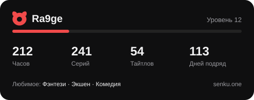

<p align="center">
  
</p>

<p align="center">
  <a href="https://senku.one"></a>
  <a href="https://senku.one/download"></a>
  <a href="../../actions/workflows/ci.yml"></a>
  <a href="../../actions/workflows/api-status.yml"></a>
</p>

# Senku

**Senku** — сайт и приложения для просмотра аниме и чтения манги онлайн: русская озвучка и субтитры, качество до 4K, история просмотра, списки, достижения и совместный просмотр с друзьями.

Это официальный репозиторий проекта для разработчиков и сообщества: SDK публичного API, фирменный стиль в виде кода, примеры, документация, история изменений и планы. Исходного кода самого сайта здесь нет.

## Что здесь есть

| | |
|---|---|
| 📦 [`packages/api`](packages/api) | **@senku/api** — TypeScript SDK для публичного API: типы, повторы, кэш, обход страниц |
| 🎨 [`packages/brand`](packages/brand) | **@senku/brand** — цвета, радиусы, шрифты и логотип как CSS-переменные и код |
| 🧪 [`examples`](examples) | Discord-бот, карточка профиля в SVG, расписание серий, клиент на Python |
| 📚 [`docs`](docs) | [Публичное API](docs/api.md) и [как устроен Senku](docs/how-senku-works.md) |
| 🖼️ [`brand`](brand) | Логотипы, иконки и баннер — правила в [BRAND.md](BRAND.md) |

## Для разработчиков

```ts
import { Senku } from '@senku/api';

const senku = new Senku({ userAgent: 'MyBot/1.0 (+https://t.me/mybot)' });

const { results } = await senku.search('Фрирен');
const anime = await senku.anime.get(results[0].id);
const rating = await senku.anime.rating(anime.id);

console.log(`${anime.title} — ${rating.avg_score} ★ (${rating.total_votes} голосов)`);
```

Карточка профиля для своего README — одна команда:

```bash
node examples/node/profile-card.mjs <ник> card.svg
```



Полный список методов — в [docs/api.md](docs/api.md), Swagger — на [senku.one/api/v2/docs](https://senku.one/api/v2/docs).

```bash
npm install
npm run typecheck
npm test
npm run build
```

## Что есть в Senku

| | |
|---|---|
| 🎬 **Аниме** | Каталог из 20 000+ тайтлов, несколько озвучек на серию, 1080p и 4K |
| 📖 **Манга** | Манга, манхва и маньхуа на русском, удобная читалка и закладки |
| 👥 **Вместе** | Совместный просмотр в комнате с синхронным плеером и голосовым чатом |
| 🏆 **Прогресс** | Уровни, достижения, коллекционные карточки, боевой пропуск и монеты |
| 💬 **Сообщество** | Комментарии, рецензии, мини-чат, друзья и сообщества |
| 🎨 **Профиль** | Рамки, анимированные баннеры, эффекты ника и иконки |
| 📱 **Приложения** | Windows и Android, вход тем же аккаунтом |
| 🔞 **18+** | Отдельный раздел за подтверждением возраста |

### Подписки

**Senku Plus** — 4K, анимированный профиль, редкие награды в достижениях, монеты за просмотр копятся быстрее, закрытый Telegram-канал и поддержка проекта.

**Hentai Plus** — раздел 18+ без цензуры, 4K там, где есть исходник, бейдж 18+ и косметика 18+ в магазине.

## Где найти

- Сайт — [senku.one](https://senku.one)
- Манга — [manga.senku.one](https://manga.senku.one)
- Приложения — [senku.one/download](https://senku.one/download)

## Документы

- [CHANGELOG.md](CHANGELOG.md) — что нового
- [ROADMAP.md](ROADMAP.md) — над чем работаем
- [CONTRIBUTING.md](CONTRIBUTING.md) — как помочь с SDK и документацией
- [SECURITY.md](SECURITY.md) — как сообщить об уязвимости
- [BRAND.md](BRAND.md) — логотип и цвета

## Обратная связь

Нашёл ошибку или есть идея? Создай [issue](../../issues/new/choose).

---

<sub>SDK в `packages/api` — под лицензией MIT. Название, логотипы и остальные материалы Senku — © 2025–2026 Senku, все права защищены, см. [LICENSE](LICENSE).</sub>
