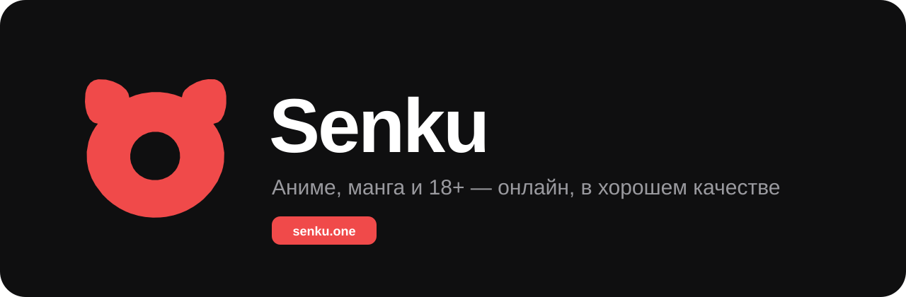

  

  
  
  

# Senku

**Senku** — сайт и приложения для просмотра аниме и чтения манги онлайн: русская озвучка и субтитры, качество до 4K, история просмотра, списки, достижения и совместный просмотр с друзьями.

Это официальный информационный репозиторий проекта: здесь фирменные материалы, история изменений, планы и место для отзывов. **Исходного кода сайта здесь нет и не будет.**

## Что есть в Senku

| | |
|---|---|
| 🎬 **Аниме** | Каталог из 20 000+ тайтлов, несколько озвучек на серию, 1080p и 4K |
| 📖 **Манга** | Манга, манхва и маньхуа на русском, удобная читалка и закладки |
| 👥 **Вместе** | Совместный просмотр в комнате с синхронным плеером и голосовым чатом |
| 🏆 **Прогресс** | Уровни, достижения, коллекционные карточки, боевой пропуск и монеты |
| 💬 **Сообщество** | Комментарии, рецензии, мини-чат, друзья и сообщества |
| 🎨 **Профиль** | Рамки, анимированные баннеры, эффекты ника и иконки |
| 📱 **Приложения** | Windows и Android, вход тем же аккаунтом |
| 🔞 **18+** | Отдельный раздел за подтверждением возраста |

## Подписки

**Senku Plus** — 4K, анимированный профиль, редкие награды в достижениях, монеты за просмотр копятся быстрее, закрытый Telegram-канал и поддержка проекта.

**Hentai Plus** — раздел 18+ без цензуры, 4K там, где есть исходник, бейдж 18+ и косметика 18+ в магазине.

Оплата — СБП или звёзды Telegram, подписка сама не продлевается.

## Где найти

- Сайт — [senku.one](https://senku.one)
- Манга — [manga.senku.one](https://manga.senku.one)
- Приложения — [senku.one/download](https://senku.one/download)

## Фирменный стиль

Логотипы, иконки и цвета лежат в папке [`brand/`](brand), правила использования — в [BRAND.md](BRAND.md).

  
  &nbsp;
  

## Документы

- [CHANGELOG.md](CHANGELOG.md) — что нового на сайте
- [ROADMAP.md](ROADMAP.md) — что мы планируем
- [SECURITY.md](SECURITY.md) — как сообщить об уязвимости
- [BRAND.md](BRAND.md) — логотип и цвета

## Обратная связь

Нашёл ошибку или есть идея? Создай [issue](../../issues/new/choose) — выбери «Ошибка на сайте» или «Идея».

---

© 2025–2026 Senku. Все права защищены. Логотипы и название Senku нельзя использовать без разрешения — см. [LICENSE](LICENSE).
