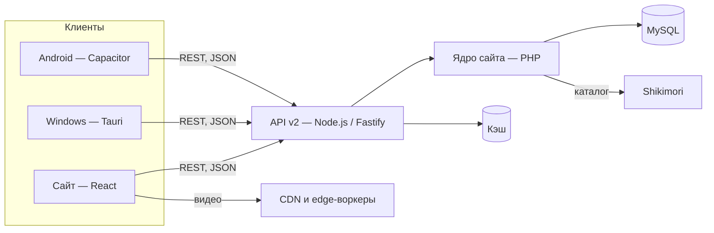

# Как устроен Senku

Короткий обзор для тех, кому интересно, что стоит за сайтом. Без паролей, адресов серверов и внутренних деталей — только общая картина.

## Клиенты

- **Сайт** — одностраничное приложение на React и Vite. Тысячи страниц аниме заранее собираются в HTML для поисковиков, а дальше страница оживает в браузере.
- **Windows** — приложение на Tauri: системное окно, автообновления, статус «смотрю» в Discord.
- **Android** — Capacitor-обёртка с нативными уведомлениями, фоновой загрузкой и плеером.

Все три ходят в одно и то же API, поэтому аккаунт, история и списки общие.

## API v2

Тонкий слой на Node.js (Fastify) перед ядром сайта. Он:

- даёт единый формат ответов `{ ok, data }` и коды ошибок;
- выдаёт токены приложениям, чтобы им не нужны были cookies;
- кэширует тяжёлые запросы;
- описан в OpenAPI — отсюда Swagger на [senku.one/api/v2/docs](https://senku.one/api/v2/docs).

## Каталог

Список тайтлов, названия и жанры приходят из Shikimori: id тайтла на Senku совпадает с id на Shikimori. Поверх этого Senku хранит свои данные — оценки зрителей, рецензии, логотипы тайтлов, расписание серий и озвучки.

## Видео

Серию можно смотреть в разных озвучках и качествах. Плеер сам выбирает качество под скорость интернета (4K вручную, только с Senku Plus), запоминает, где ты остановился, и умеет пропускать опенинги и эндинги — их тайминги собираются по просмотрам. Тяжёлый трафик идёт через CDN и edge-воркеры, а не через основной сервер.

## Прогресс и награды

Серия засчитывается, когда большая часть её реально просмотрена. Засчитанные серии дают опыт и монеты, открывают достижения, коллекционные карточки и уровни боевого пропуска. Монеты тратятся в магазине на рамки, баннеры и эффекты ника.

## Совместный просмотр

В комнате плееры участников синхронизируются: пауза, перемотка и смена серии видны всем. Голосовой чат работает напрямую между участниками (WebRTC), а сервер помогает только с соединением.

## Безопасность

- Админ-панель — отдельный вход с двухфакторной проверкой, журналом действий и строгой политикой контента.
- Подписки и доступ к 18+ проверяются на сервере, а не только в интерфейсе.
- Нашёл уязвимость — см. [SECURITY.md](../SECURITY.md).
